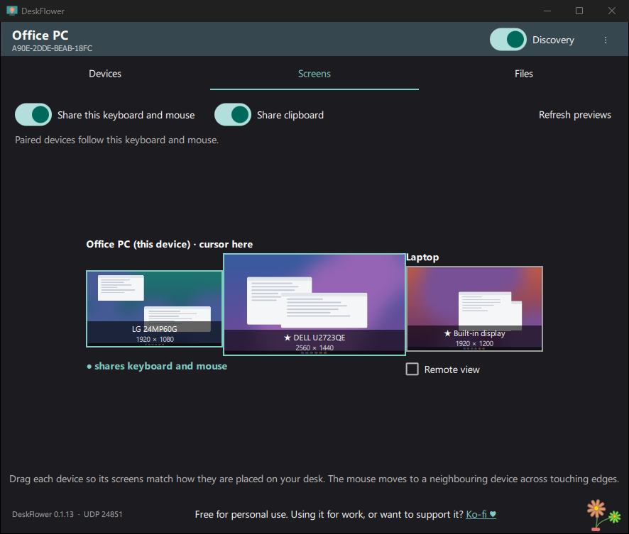

# DeskFlower

One keyboard, mouse and clipboard for several computers on your network. Move the cursor off the
edge of one screen and it continues on the next computer; copy on one, paste on another; drag files
across. Windows, Linux and macOS, built with Qt 6.

**[Website and guide](https://bnogalm.github.io/DeskFlower/)** ·
**[Download](https://github.com/bnogalm/DeskFlower/releases/latest)**

> **Beta testers wanted for Linux and macOS.** Windows is used daily; the Linux and macOS versions
> are built by CI and tested in Docker (Linux), but have not been tried on real desktops, and the
> macOS version has never been run: I have no Mac to test it on. If you can try either, please
> [open an issue](https://github.com/bnogalm/DeskFlower/issues) with what works and what does not
> (logs help: add `"logging": true` to `~/.config/Deskflower/deskflower/settings.json` on Linux or
> `~/Library/Preferences/Deskflower/deskflower/settings.json` on macOS, then log out and back in).



## Features

- **Keyboard and mouse sharing:** arrange the screens of every device by dragging them; the cursor
  crosses at the edges, and each device applies its own keyboard layout.
- **Clipboard:** text, HTML, images, files and folders, copied on one device and pasted on another.
- **File drag and drop** between devices.
- **Remote view:** show another device's screens full screen on your monitors and control it, for a
  computer on another desk.
- **Phone access:** an HTTPS web app on the local network to send and fetch files from a phone.
- **Updates from paired devices:** a device can update the others with a signed package.
- **Works across routers:** devices on other networks can be added by IP address.

## Security

- Devices pair with a one-time **6-digit PIN** (CPace); nothing works with an unpaired device.
- All traffic is **encrypted** (Noise IK, ChaCha20-Poly1305), and the clipboard is sealed with a
  fresh key for every copy.
- **Trust levels** per device: *Guest* (a device that is not yours: it cannot control this one, and
  reads the clipboard only when you paste on it), *This device only*, or *All my devices* (one PIN
  pairs a new device with your whole group).
- On Windows the service acts on files only with the signed-in user's rights.

## Install

| Platform | Package | Notes |
|---|---|---|
| Windows (x64) | `Deskflower-<version>-Windows-x64.msi` | Installs the service, firewall rules and Start menu shortcut |
| Linux (x86-64) | `deskflower_<version>-Linux-amd64.deb` | Beta; X11, or Wayland with GNOME 45+ / KDE Plasma 6.1+ |
| macOS (Apple silicon) | `deskflower-<version>-macOS-arm64.dmg` | Beta, never run on a real Mac. Not notarized: allow it under *Privacy & Security → Open Anyway*, then grant *Accessibility*, *Input Monitoring* and *Screen Recording* |

Open DeskFlower on each device, click **Pair** next to the other device and type the PIN it shows,
then arrange the screens in the **Screens** tab.

Network: UDP 24800-24801 and TCP 24801 (plus TCP 24802 for phone access). The Windows installer
opens them; on Linux and macOS allow them in your firewall.

## Building

Requires Qt 6.8+, libsodium and OpenSSL 3 (Linux: also the X11, libei and PipeWire development
packages).

```bat
:: Windows (Visual Studio 2022, Qt in C:\Qt; libsodium is downloaded automatically)
scripts\build-windows.bat win-debug
ctest --test-dir build\win-debug
scripts\package-windows.bat            :: release build and MSI in dist\
```

```sh
# Linux / macOS
cmake --preset unix-debug -DCMAKE_PREFIX_PATH=/path/to/Qt/6.x/<platform>
cmake --build --preset unix-debug
ctest --test-dir build/unix-debug
```

## Documentation

- [docs/DESIGN.md](docs/DESIGN.md): architecture, security model, networking, clipboard, files,
  installers, signed updates, logs and ports.
- [docs/TESTING.md](docs/TESTING.md): the test suites and the manual checklist.

## License

DeskFlower is licensed under the [PolyForm Noncommercial License 1.0.0](LICENSE.md): free for
personal use and for noncommercial organizations. Any work use (companies of any size, freelancers,
self-employed) needs a [commercial license](COMMERCIAL-LICENSE.md): **5 € per user, once, for
life**, VAT included, paid at <https://ko-fi.com/bnogal> (write the number of users and your billing
country in the message). Full invoices: ask at vegawallet@gmail.com with the Ko-fi receipt.

Third-party software (Qt under the LGPL v3, OpenSSL, libsodium, QR Code generator) is listed in
[THIRD-PARTY-NOTICES.md](THIRD-PARTY-NOTICES.md), with the license texts in `licenses/`.
